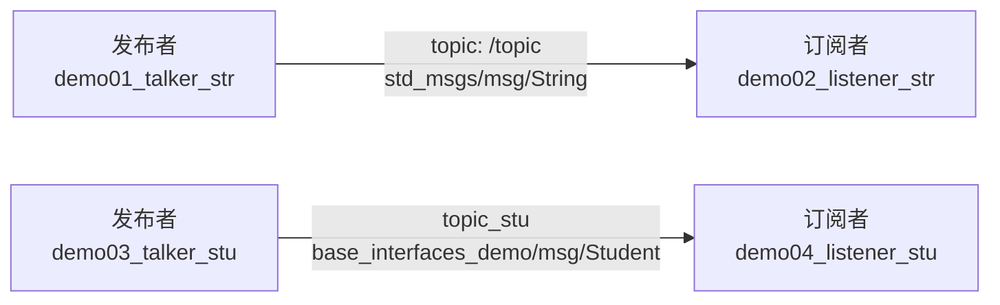
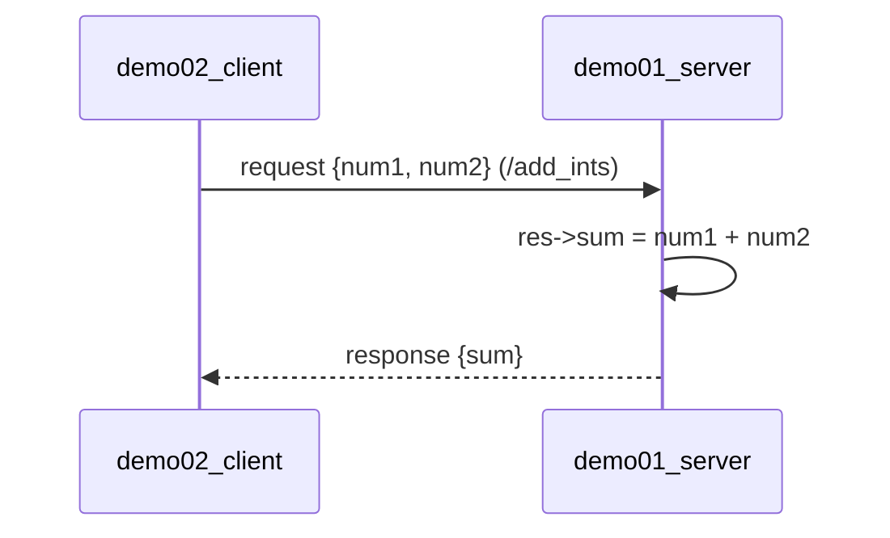
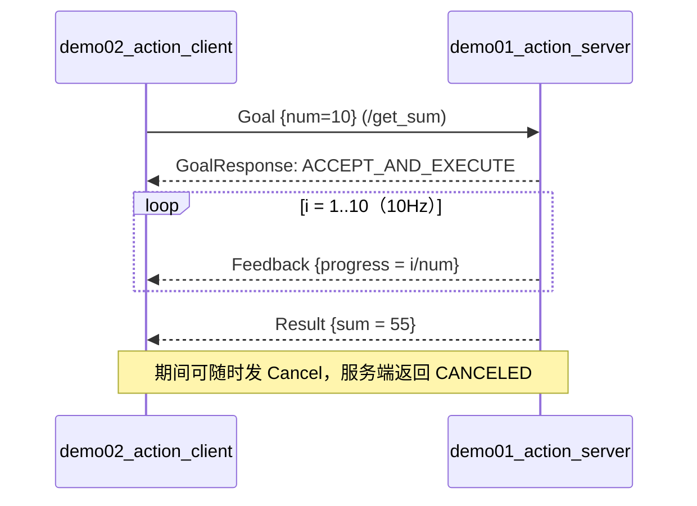

# ROS 2 三大通信机制总结（话题 / 服务 / 动作）

> 本文件汇总本项目 `cpp01_topic`、`cpp02_service`、`cpp03_action` 三个功能包的全部代码，
> 以及自定义接口包 `base_interfaces_demo` 和它们的 `CMakeLists.txt`。
>
> **阅读方式：总结的"框架"直接写进了代码注释**——每个代码文件开头都有一段
> `【框架 X-Y】` 注释，说明该文件属于哪条通信链路、按什么步骤组织；
> 代码内部用 `// 【步骤 N】` 标注这一步在框架中的位置。
> 代码逻辑与工程中的原文件保持一致，注释为便于学习而补充。

---

## 目录

- [一、总览：三张图看懂三种通信](#一总览三张图看懂三种通信)
- [二、三种机制对比表](#二三种机制对比表)
- [三、自定义接口包 base_interfaces_demo](#三自定义接口包-base_interfaces_demo)
- [四、话题通信 cpp01_topic](#四话题通信-cpp01_topic)
- [五、服务通信 cpp02_service](#五服务通信-cpp02_service)
- [六、动作通信 cpp03_action](#六动作通信-cpp03_action)
- [七、编译、运行与调试命令](#七编译运行与调试命令)
- [八、易踩的坑（本项目实测）](#八易踩的坑本项目实测)

---

## 一、总览：三张图看懂三种通信

### 1. 话题（Topic）—— 单向、异步、多对多



### 2. 服务（Service）—— 请求/响应、同步等待



### 3. 动作（Action）—— 目标 + 连续反馈 + 最终结果，可取消



---

## 二、三种机制对比表

| 维度 | 话题 Topic | 服务 Service | 动作 Action |
| --- | --- | --- | --- |
| 通信方向 | 单向（发布 → 订阅） | 双向（请求 → 响应） | 双向 + 持续反馈 |
| 同步性 | 异步、无阻塞 | 客户端同步/异步等结果 | 异步，靠回调驱动 |
| 对应关系 | 多对多 | 多对一（一个服务端可被多个客户端调用） | 多对一 |
| 典型节点对 | `create_publisher` / `create_subscription` | `create_service` / `create_client` | `rclcpp_action::create_server` / `create_client` |
| 接口定义文件 | `.msg` | `.srv`（`---` 分隔请求/响应） | `.action`（两个 `---` 分隔 Goal/Result/Feedback） |
| 底层实现 | DDS 发布订阅 | 基于话题的请求/响应封装 | 由"服务 + 话题"组合而成 |
| 本项目示例 | 字符串、自定义 `Student` | 两数求和 `AddInts` | 累加求和并上报进度 `Progress` |
| 是否可打断 | 无所谓打断（无状态） | 只能等超时 | 可 `cancel`，并可读取中间反馈 |
| 依赖库 | `rclcpp` | `rclcpp` | `rclcpp` + `rclcpp_action` |

> **关键判断**：需要"持续状态反馈 + 可中途取消" → 用动作；
> 只需"一问一答" → 用服务；只需"持续广播数据" → 用话题。

---

## 三、自定义接口包 base_interfaces_demo

### 3.1 包结构

```text
base_interfaces_demo/
├── CMakeLists.txt
├── package.xml
├── msg/Student.msg
├── srv/AddInts.srv
└── action/Progress.action
```

### 3.2 接口文件（全部代码）

```text
# ============================================================
# 【框架 3-1】消息接口 msg/Student.msg
# 一句话：只描述"数据结构"，没有方向性，发布者和订阅者共用
# 生成 C++: base_interfaces_demo/msg/student.hpp
#           -> base_interfaces_demo::msg::Student
# ============================================================

# 【字段 1】姓名
string name
# 【字段 2】年龄
int32 age
# 【字段 3】身高
float64 height
```

```text
# ============================================================
# 【框架 3-2】服务接口 srv/AddInts.srv
# 一句话：--- 之上是"请求(Request)"，之下是"响应(Response)"
# 生成 C++: base_interfaces_demo/srv/add_ints.hpp
#           -> AddInts::Request { num1, num2 }
#           -> AddInts::Response { sum }
# ============================================================

int32 num1
int32 num2
---
int32 sum
```

```text
# ============================================================
# 【框架 3-3】动作接口 action/Progress.action
# 一句话：两个 --- 把文件切成三段，顺序固定
#   第 1 段 Goal      : 客户端发起的目标    -> Progress::Goal
#   第 2 段 Result    : 服务端最终结果      -> Progress::Result
#   第 3 段 Feedback  : 执行过程中的反馈    -> Progress::Feedback
# 生成 C++: base_interfaces_demo/action/progress.hpp
# ============================================================

# 【第 1 段 Goal】要累加的上限
int64 num
---
# 【第 2 段 Result】累加结果
int64 sum
---
# 【第 3 段 Feedback】进度百分比 0.0 ~ 1.0
float64 progress
```

### 3.3 CMakeLists.txt（全部代码）

```cmake
# ============================================================
# 【框架 3-4】接口包 CMakeLists 的四步骨架
#   1) 声明项目 + 找依赖（必须找到 rosidl_default_generators）
#   2) rosidl_generate_interfaces() 列出所有 .msg/.srv/.action
#   3) ament_export_dependencies(rosidl_default_runtime) 导出运行时
#   4) ament_package()
# ============================================================
cmake_minimum_required(VERSION 3.20)
project(base_interfaces_demo)

# 【步骤 0】编译告警开关（ROS 2 模板默认）
if(CMAKE_COMPILER_IS_GNUCXX OR CMAKE_CXX_COMPILER_ID MATCHES "Clang")
  add_compile_options(-Wall -Wextra -Wpedantic)
endif()

# find dependencies
# 【步骤 1】找到接口生成器；编译器插件与运行时都靠它
find_package(ament_cmake REQUIRED)
find_package(rclcpp REQUIRED)
find_package(std_msgs REQUIRED)
find_package(rosidl_default_generators REQUIRED)

# 【步骤 2】核心命令：把接口文件变成 C++ 头文件（.hpp）
#   路径必须与磁盘上的实际文件一一对应
rosidl_generate_interfaces(${PROJECT_NAME}
  "msg/Student.msg"
  "srv/AddInts.srv"
  "action/Progress.action"
)

# 【步骤 3】别的包依赖本包时，需要运行时依赖被一起导出
# 【步骤 4】ament_package()
ament_export_dependencies(rosidl_default_runtime)

if(BUILD_TESTING)
  find_package(ament_lint_auto REQUIRED)
  # the following line skips the linter which checks for copyrights
  # comment the line when a copyright and license is added to all source files
  set(ament_cmake_copyright_FOUND TRUE)
  # the following line skips cpplint (only works in a git repo)
  # comment the line when this package is in a git repo and when
  # a copyright and license is added to all source files
  set(ament_cmake_cpplint_FOUND TRUE)
  ament_lint_auto_find_test_dependencies()
endif()

ament_package()
```

### 3.4 package.xml（全部代码）

```xml
<?xml version="1.0"?>
<?xml-model href="http://download.ros.org/schema/package_format3.xsd" schematypens="http://www.w3.org/2001/XMLSchema"?>
<!--
【框架 3-5】自定义接口包 package.xml 的必备条件：
  1) buildtool_depend: rosidl_default_generators   -> 能生成代码
  2) member_of_group:  rosidl_interface_packages   -> 被 rosidl 生态识别为接口包
  3) 同一依赖只声明一次：rosidl_default_generators 是构建工具，
     写在 buildtool_depend 里就够了，再写一遍 <depend> 会触发 ament 告警
  缺 1) 或 2)，编译期会报找不到 xxx/msg/xxx.hpp
-->
<package format="3">
  <name>base_interfaces_demo</name>
  <version>0.0.0</version>
  <description>TODO: Package description</description>
  <maintainer email="qiutieling653@gmail.com">OH-MY-GOD-qtl</maintainer>
  <license>TODO: License declaration</license>

  <buildtool_depend>ament_cmake</buildtool_depend>

  <depend>rclcpp</depend>
  <depend>std_msgs</depend>
  <depend>action_msgs</depend>
  <exec_depend>rosidl_default_runtime</exec_depend>

  <buildtool_depend>rosidl_default_generators</buildtool_depend>

  <member_of_group>rosidl_interface_packages</member_of_group>

  <test_depend>ament_lint_auto</test_depend>
  <test_depend>ament_lint_common</test_depend>

  <export>
    <build_type>ament_cmake</build_type>
  </export>
</package>
```

---

## 四、话题通信 cpp01_topic

### 4.1 框架总览

```text
【话题四件套】
  1. 继承 rclcpp::Node 自定义节点类
  2. 构造函数里创建 publisher / subscription（含话题名 + QoS 队列深度）
  3. 回调函数里 组装消息 / 处理消息
  4. main 中 rclcpp::init -> spin -> shutdown

发布端：timer 触发 -> 填消息 -> publish()
订阅端：消息到达 -> 回调自动执行（由 spin 驱动）
```

### 4.2 CMakeLists.txt（全部代码）

```cmake
# ============================================================
# 【框架 4-1】话题包 CMakeLists 的五步骨架
#   1) project + 编译告警
#   2) find_package: rclcpp / std_msgs / 自定义接口包
#   3) add_executable      每个 demo 一个可执行文件
#   4) target_link_libraries + target_compile_features
#   5) install(TARGETS ... DESTINATION lib/${PROJECT_NAME})
#       -> 只有第 5 步装了，ros2 run 才找得到
# ============================================================
cmake_minimum_required(VERSION 3.20)
project(cpp01_topic)

# 【步骤 1】写告警提示，方便发现类型/未使用变量问题
if(CMAKE_COMPILER_IS_GNUCXX OR CMAKE_CXX_COMPILER_ID MATCHES "Clang")
  add_compile_options(-Wall -Wextra -Wpedantic)
endif()

# find dependencies
# 【步骤 2】std_msgs 给 String 用；base_interfaces_demo 给 Student 用
find_package(ament_cmake REQUIRED)
find_package(rclcpp REQUIRED)
find_package(std_msgs REQUIRED)
find_package(base_interfaces_demo REQUIRED)

# 【步骤 3】四个 demo 各自独立成可执行文件
add_executable(demo01_talker_str src/demo01_talker_str.cpp)
add_executable(demo02_listener_str src/demo02_listener_str.cpp)
add_executable(demo03_talker_stu src/demo03_talker_stu.cpp)
add_executable(demo04_listener_stu src/demo04_listener_stu.cpp)

# 【步骤 4】链接依赖：rclcpp 固定，其余用 ${包名_TARGETS} 展开
target_link_libraries(demo01_talker_str PUBLIC
  rclcpp::rclcpp
  ${std_msgs_TARGETS}
  ${base_interfaces_demo_TARGETS}
)

target_link_libraries(demo02_listener_str PUBLIC
  rclcpp::rclcpp
  ${std_msgs_TARGETS}
  ${base_interfaces_demo_TARGETS}
)

target_link_libraries(demo03_talker_stu PUBLIC
  rclcpp::rclcpp
  ${std_msgs_TARGETS}
  ${base_interfaces_demo_TARGETS}
)

target_link_libraries(demo04_listener_stu PUBLIC
  rclcpp::rclcpp
  ${std_msgs_TARGETS}
  ${base_interfaces_demo_TARGETS}
)

# 【步骤 4'】C++17（rclcpp 要求）
target_compile_features(demo01_talker_str PUBLIC cxx_std_17)
target_compile_features(demo02_listener_str PUBLIC cxx_std_17)
target_compile_features(demo03_talker_stu PUBLIC cxx_std_17)
target_compile_features(demo04_listener_stu PUBLIC cxx_std_17)

# 【步骤 5】安装到 lib/cpp01_topic，ros2 run 从这里找
install(TARGETS
  demo01_talker_str
  demo02_listener_str
  demo03_talker_stu
  demo04_listener_stu
  DESTINATION lib/${PROJECT_NAME}
)

if(BUILD_TESTING)
  find_package(ament_lint_auto REQUIRED)
  # the following line skips the linter which checks for copyrights
  # comment the line when a copyright and license is added to all source files
  set(ament_cmake_copyright_FOUND TRUE)
  # the following line skips cpplint (only works in a git repo)
  # comment the line when this package is in a git repo and when
  # a copyright and license is added to all source files
  set(ament_cmake_cpplint_FOUND TRUE)
  ament_lint_auto_find_test_dependencies()
endif()

ament_package()
```

### 4.3 package.xml（全部代码）

```xml
<?xml version="1.0"?>
<?xml-model href="http://download.ros.org/schema/package_format3.xsd" schematypens="http://www.w3.org/2001/XMLSchema"?>
<!--
【框架 4-2】cpp01_topic 的依赖 = rclcpp（通信核心）+ std_msgs（内置消息）
                              + base_interfaces_demo（自定义 Student 消息）
-->
<package format="3">
  <name>cpp01_topic</name>
  <version>0.0.0</version>
  <description>TODO: Package description</description>
  <maintainer email="qiutieling653@gmail.com">OH-MY-GOD-qtl</maintainer>
  <license>TODO: License declaration</license>

  <buildtool_depend>ament_cmake</buildtool_depend>

  <depend>rclcpp</depend>
  <depend>std_msgs</depend>
  <depend>base_interfaces_demo</depend>

  <test_depend>ament_lint_auto</test_depend>
  <test_depend>ament_lint_common</test_depend>

  <export>
    <build_type>ament_cmake</build_type>
  </export>
</package>
```

### 4.4 发布者：`src/demo01_talker_str.cpp`（全部代码）

```cpp
// ============================================================
// 【框架 4-3】话题通信 · 发布者（Publisher，内置消息 std_msgs/msg/String）
// 步骤：
//   1. 定义类继承 rclcpp::Node，构造时给节点起名 "minimal_publisher"
//   2. create_publisher<消息类型>(话题名, QoS 队列长度 10)
//   3. create_wall_timer(500ms, 回调) —— 用定时器"驱动"发布节奏
//   4. 回调内：new 消息 -> 填 data -> publish()
//   5. main: init -> spin(节点) -> shutdown
// 关键点：spin 负责让定时器回调真正被执行；不 spin 就永远不发消息
// ============================================================
#include <rclcpp/rclcpp.hpp>
#include <std_msgs/msg/string.hpp>

using namespace std::chrono_literals;

class MinimalPublisher : public rclcpp::Node
{
public:
    MinimalPublisher() : Node("minimal_publisher")
    {
        // 【步骤 2】创建发布者：话题名 "topic"，队列深度 10
        //          参数顺序：话题名 -> QoS(历史深度)
        publisher_ = this->create_publisher<std_msgs::msg::String>("topic", 10);

        // 【步骤 3】500ms 周期的墙钟定时器，回调绑定到 timer_callback
        timer_ = this->create_wall_timer(500ms, std::bind(&MinimalPublisher::timer_callback, this));
    }

private:
    // 【步骤 4】发布逻辑：组装消息 -> 打日志 -> 发布
    void timer_callback()
    {
        auto message = std_msgs::msg::String();
        message.data = "Hello, world!" + std::to_string(count_++);
        RCLCPP_INFO(this->get_logger(), "Publishing: '%s'", message.data.c_str());
        publisher_->publish(message);
    }
    rclcpp::TimerBase::SharedPtr timer_;                              // 定时器句柄
    rclcpp::Publisher<std_msgs::msg::String>::SharedPtr publisher_;   // 发布者句柄
    size_t count_ = 0;                                               // 消息序号
};

int main(int argc, char * argv[])
{
    // 【步骤 5】初始化 -> 自旋 -> 关闭，ROS 2 程序的固定收尾
    rclcpp::init(argc, argv);
    rclcpp::spin(std::make_shared<MinimalPublisher>());
    rclcpp::shutdown();
}
```

### 4.5 订阅者：`src/demo02_listener_str.cpp`（全部代码）

```cpp
// ============================================================
// 【框架 4-4】话题通信 · 订阅者（Subscriber，内置消息 std_msgs/msg/String）
// 步骤：
//   1. 类继承 rclcpp::Node，节点名 "minimal_subscriber"
//   2. create_subscription<消息类型>(话题名, QoS 10, 回调)
//   3. 回调参数必须是 const 引用（const std_msgs::msg::String &）
//   4. main 里 spin —— 消息一到，回调自动被调用
// 关键点：话题名 "topic" 必须和发布者完全一致（含大小写），才会连上
// ============================================================
#include <rclcpp/rclcpp.hpp>
#include <std_msgs/msg/string.hpp>

using std::placeholders::_1;   // 回调占位符

class MinimalSubscriber : public rclcpp::Node
{
public:
    MinimalSubscriber() : Node("minimal_subscriber")
    {
        // 【步骤 2】订阅：话题名 "topic" + 队列 10 + 成员函数回调
        subscription_ = this->create_subscription<std_msgs::msg::String>("topic", 10, std::bind(&MinimalSubscriber::topic_Callback, this, _1));
    }

private:
    // 【步骤 3】回调：只读处理消息，返回 void
    void topic_Callback(const std_msgs::msg::String & msg) const
    {
        RCLCPP_INFO(this->get_logger(), "I heard: [%s]", msg.data.c_str());
    }
    rclcpp::Subscription<std_msgs::msg::String>::SharedPtr subscription_;   // 订阅者句柄
};

int main(int argc, char * argv[])
{
    // 【步骤 4】init -> spin -> shutdown
    rclcpp::init(argc, argv);
    rclcpp::spin(std::make_shared<MinimalSubscriber>());
    rclcpp::shutdown();
}
```

### 4.6 自定义消息发布者：`src/demo03_talker_stu.cpp`（全部代码）

```cpp
// ============================================================
// 【框架 4-5】话题通信 · 发布者（自定义消息 base_interfaces_demo/msg/Student）
// 与 4-3 的差异只有三处：
//   a. include 换成 <base_interfaces_demo/msg/student.hpp>
//   b. 模板参数 / 消息类型换成 Student
//   c. 消息是多字段结构体，逐个字段赋值
// 话题名换成 "topic_stu"，与订阅端严格对应
// ============================================================
#include <base_interfaces_demo/msg/student.hpp>
#include <rclcpp/rclcpp.hpp>

using namespace std::chrono_literals;
using base_interfaces_demo::msg::Student;   // 【差异 a】自定义消息类型别名

class MinimalPublisher : public rclcpp::Node
{
public:
    MinimalPublisher() : Node("minimal_publisher"), count_(0)
    {
        // 【步骤 2】【差异 b】发布自定义消息到话题 "topic_stu"
        publisher_ = this->create_publisher<Student>("topic_stu", 10);
        // 【步骤 3】500ms 周期定时发布
        timer_ = this->create_wall_timer(500ms, std::bind(&MinimalPublisher::timer_callback, this));
    }

private:
    void timer_callback()
    {
        // 【步骤 4】【差异 c】逐字段填充消息内容
        auto stu = Student();
        stu.name = "qtl";
        stu.age = 20;
        stu.height = 1.82;
        RCLCPP_INFO(this->get_logger(), "Publishing: name: '%s', age: '%d', height: '%.2f'", stu.name.c_str(), stu.age, stu.height);
        publisher_->publish(stu);
    }
    rclcpp::Publisher<Student>::SharedPtr publisher_;
    rclcpp::TimerBase::SharedPtr timer_;
    size_t count_;
};

int main(int argc, char * argv[])
{
    rclcpp::init(argc, argv);
    rclcpp::spin(std::make_shared<MinimalPublisher>());
    rclcpp::shutdown();
}
```

### 4.7 自定义消息订阅者：`src/demo04_listener_stu.cpp`（全部代码）

```cpp
// ============================================================
// 【框架 4-6】话题通信 · 订阅者（自定义消息 Student）
// 与 4-4 的差异只有两处：
//   a. include / 模板参数换成 Student
//   b. 回调里访问的是 msg.name / msg.age / msg.height 多个字段
// ============================================================
#include <base_interfaces_demo/msg/student.hpp>
#include <rclcpp/rclcpp.hpp>

using base_interfaces_demo::msg::Student;
using std::placeholders::_1;

class MinimalSubscriber : public rclcpp::Node
{
public:
    MinimalSubscriber() : Node("minimal_subscriber")
    {
        // 【步骤 2】订阅话题 "topic_stu"，与 demo03_talker_stu 对应
        subscription_ = this->create_subscription<Student>(
            "topic_stu", 10, std::bind(&MinimalSubscriber::topic_callback, this, _1));
    }

private:
    // 【步骤 3】回调读取自定义消息的多个字段
    void topic_callback(const Student & msg) const
    {
        RCLCPP_INFO(this->get_logger(), "subscription message: name=%s, age=%d, height=%.2f", msg.name.c_str(), msg.age, msg.height);
    }
    rclcpp::Subscription<Student>::SharedPtr subscription_;
};

int main(int argc, char * argv[])
{
    rclcpp::init(argc, argv);
    rclcpp::spin(std::make_shared<MinimalSubscriber>());
    rclcpp::shutdown();
}
```

---

## 五、服务通信 cpp02_service

### 5.1 框架总览

```text
【服务四件套】
  服务端：类继承 Node -> create_service<AddInts>(服务名, 回调)
          回调签名 void(const Request::SharedPtr, Response::SharedPtr)
          -> 在回调里把结果写进 res->sum
  客户端：类继承 Node -> create_client<AddInts>(服务名)
          -> wait_for_service() 等服务上线
          -> async_send_request(请求) 拿到 future
          -> spin_until_future_complete() 阻塞等结果
```

### 5.2 CMakeLists.txt（全部代码）

```cmake
# ============================================================
# 【框架 5-1】服务包 CMakeLists 骨架（与话题包几乎一致）
#   与话题包的唯一区别：不需要 std_msgs，
#   只依赖 rclcpp + 自定义接口包（服务类型来自接口包）
# ============================================================
cmake_minimum_required(VERSION 3.20)
project(cpp02_service)

if(CMAKE_COMPILER_IS_GNUCXX OR CMAKE_CXX_COMPILER_ID MATCHES "Clang")
  add_compile_options(-Wall -Wextra -Wpedantic)
endif()

# find dependencies
# 【步骤 2】服务端/客户端共用同一个 AddInts 接口，都来自 base_interfaces_demo
find_package(ament_cmake REQUIRED)
find_package(rclcpp REQUIRED)
find_package(base_interfaces_demo REQUIRED)

# 【步骤 3】两个可执行文件：服务端 + 客户端
add_executable(demo01_server src/demo01_server.cpp)
add_executable(demo02_client src/demo02_client.cpp)

# 【步骤 4】链接 rclcpp 与接口包
target_link_libraries(demo01_server PUBLIC
  rclcpp::rclcpp
  ${base_interfaces_demo_TARGETS}
)
target_link_libraries(demo02_client PUBLIC
  rclcpp::rclcpp
  ${base_interfaces_demo_TARGETS}
)

target_compile_features(demo01_server PUBLIC cxx_std_17)
target_compile_features(demo02_client PUBLIC cxx_std_17)

# 【步骤 5】安装，ros2 run 才能找到
install(TARGETS
  demo01_server demo02_client
  DESTINATION lib/${PROJECT_NAME}
)

if(BUILD_TESTING)
  find_package(ament_lint_auto REQUIRED)
  # the following line skips the linter which checks for copyrights
  # comment the line when a copyright and license is added to all source files
  set(ament_cmake_copyright_FOUND TRUE)
  # the following line skips cpplint (only works in a git repo)
  # comment the line when this package is in a git repo and when
  # a copyright and license is added to all source files
  set(ament_cmake_cpplint_FOUND TRUE)
  ament_lint_auto_find_test_dependencies()
endif()

ament_package()
```

### 5.3 package.xml（全部代码）

```xml
<?xml version="1.0"?>
<?xml-model href="http://download.ros.org/schema/package_format3.xsd" schematypens="http://www.w3.org/2001/XMLSchema"?>
<!--
【框架 5-2】服务包依赖：rclcpp + base_interfaces_demo（AddInts.srv）
            注意 rclcpp 已内含服务通信能力，不需要额外 rclcpp_service
-->
<package format="3">
  <name>cpp02_service</name>
  <version>0.0.0</version>
  <description>TODO: Package description</description>
  <maintainer email="qiutieling653@gmail.com">OH-MY-GOD-qtl</maintainer>
  <license>TODO: License declaration</license>

  <buildtool_depend>ament_cmake</buildtool_depend>

  <depend>rclcpp</depend>
  <depend>base_interfaces_demo</depend>

  <test_depend>ament_lint_auto</test_depend>
  <test_depend>ament_lint_common</test_depend>

  <export>
    <build_type>ament_cmake</build_type>
  </export>
</package>
```

### 5.4 服务端：`src/demo01_server.cpp`（全部代码）

```cpp
// ============================================================
// 【框架 5-3】服务通信 · 服务端（Server）
// 步骤：
//   1. 类继承 rclcpp::Node，节点名 "minimal_service"
//   2. create_service<AddInts>("add_ints", 回调)
//   3. 回调签名固定：void(const AddInts::Request::SharedPtr,
//                          AddInts::Response::SharedPtr)
//      —— 请求只读、响应可写
//   4. 把计算结果写进 res->sum；ROS 2 自动把 response 发回客户端
// 关键点：服务端本身是"被动"的，靠 spin 等待请求到来
// ============================================================
#include <base_interfaces_demo/srv/add_ints.hpp>
#include <rclcpp/rclcpp.hpp>

using base_interfaces_demo::srv::AddInts;
using std::placeholders::_1;
using std::placeholders::_2;

class MinimalService : public rclcpp::Node
{
public:
    MinimalService() : Node("minimal_service")
    {
        // 【步骤 2】创建服务：服务名 "add_ints"（客户端必须同名）
        server = this->create_service<AddInts>("add_ints", std::bind(&MinimalService::add, this, _1, _2));
        RCLCPP_INFO(this->get_logger(), "Service 'add_ints' is ready.");
    }

private:
    rclcpp::Service<AddInts>::SharedPtr server;   // 服务端句柄

    // 【步骤 3】请求 -> 响应 的回调
    void add(const AddInts::Request::SharedPtr req, AddInts::Response::SharedPtr res)
    {
        // 【步骤 4】业务逻辑 + 写入响应字段
        res->sum = req->num1 + req->num2;
        RCLCPP_INFO(this->get_logger(), "Incoming request: num1=%d, num2=%d, sum=%d", req->num1, req->num2, res->sum);
    }
};

int main(int argc, char * argv[])
{
    rclcpp::init(argc, argv);
    rclcpp::spin(std::make_shared<MinimalService>());   // spin 等待并处理请求
    rclcpp::shutdown();
}
```

### 5.5 客户端：`src/demo02_client.cpp`（全部代码）

```cpp
// ============================================================
// 【框架 5-4】服务通信 · 客户端（Client）
// 四个动作，缺一不可：
//   1. create_client<AddInts>("add_ints")            创建客户端
//   2. wait_for_service(1s) 循环等待                 服务上线
//   3. async_send_request(请求)                      发出请求，拿到 future
//   4. spin_until_future_complete(node, future)      阻塞等待结果
//      —— 返回 SUCCESS 才能 .get()->sum 取结果
// 本 demo 从命令行取两个整数：ros2 run cpp02_service demo02_client 3 5
// ============================================================
#include <base_interfaces_demo/srv/add_ints.hpp>
#include <rclcpp/rclcpp.hpp>

using base_interfaces_demo::srv::AddInts;
using namespace std::chrono_literals;

class MinimalClient : public rclcpp::Node
{
public:
    MinimalClient() : Node("minimal_client")
    {
        // 【步骤 1】创建客户端，服务名必须与服务端一致
        client = this->create_client<AddInts>("add_ints");
        RCLCPP_INFO(this->get_logger(), "Client 'add_ints' is ready.");
    }

    // 【步骤 2】阻塞等待服务上线；中途 Ctrl+C 可安全退出
    bool connect_server()
    {
        while (!client->wait_for_service(1s)) {
            if (!rclcpp::ok()) {
                RCLCPP_INFO(
                    this->get_logger(), "Interrupted while waiting for the service. Exiting.");
                return false;
            }
            RCLCPP_INFO(this->get_logger(), "Service not available, waiting again...");
        }
        return true;
    }

    // 【步骤 3】组装请求并异步发送，返回 FutureAndRequestId 供后续等待
    rclcpp::Client<AddInts>::FutureAndRequestId send_request(int32_t num1, int32_t num2)
    {
        auto request = std::make_shared<AddInts::Request>();
        request->num1 = num1;
        request->num2 = num2;
        RCLCPP_INFO(this->get_logger(), "Sending request: num1=%d, num2=%d", num1, num2);
        return client->async_send_request(request);
    }

private:
    rclcpp::Client<AddInts>::SharedPtr client;    // 客户端句柄
};

int main(int argc, char * argv[])
{
    // 【前置检查】必须传两个整数，否则直接退出
    if (argc != 3) {
        RCLCPP_INFO(
            rclcpp::get_logger("rclcpp"), "Please provide two integers as command line arguments.");
        return 1;
    }
    rclcpp::init(argc, argv);
    auto client = std::make_shared<MinimalClient>();

    // 【步骤 2】先确保服务端在
    bool flag = client->connect_server();
    if (!flag) {
        RCLCPP_INFO(rclcpp::get_logger("rclcpp"), "Service connection failed!");
        return 0;
    }

    // 【步骤 3】发请求
    auto response = client->send_request(atoi(argv[1]), atoi(argv[2]));

    // 【步骤 4】阻塞等结果：SUCCESS -> 取 sum；否则视为失败
    if (rclcpp::spin_until_future_complete(client, response) == rclcpp::FutureReturnCode::SUCCESS) {
        RCLCPP_INFO(rclcpp::get_logger("rclcpp"), "Result: %d", response.get()->sum);
    } else {
        RCLCPP_INFO(rclcpp::get_logger("rclcpp"), "Failed to call service 'add_ints'.");
    }
    rclcpp::shutdown();
    return 0;
}
```

---

## 六、动作通信 cpp03_action

### 6.1 框架总览

```text
【动作 = 服务 + 话题 的组合】

服务端三个回调（create_server 一次性注册）：
  handle_goal(uuid, goal)      -> 决定 ACCEPT / REJECT
  handle_cancel(goal_handle)   -> 决定 ACCEPT / REJECT
  handle_accepted(goal_handle) -> 真正开线程执行 execute()
  execute() 里做三件事：
      goal_handle->publish_feedback(...)   发进度
      goal_handle->is_canceling()          检查取消
      goal_handle->succeed(result)         结束并返回结果

客户端三个回调（SendGoalOptions 里注册）：
  goal_response_callback   -> 目标是否被接受
  feedback_callback        -> 收到进度反馈
  result_callback          -> 最终结果 + 状态码（SUCCEEDED/ABORTED/CANCELED）
```

### 6.2 CMakeLists.txt（全部代码）

```cmake
# ============================================================
# 【框架 6-1】动作包 CMakeLists 骨架（五步，与话题/服务包同构）
#   与话题/服务包的两个关键差异：
#     a. 必须 find_package(rclcpp_action REQUIRED)
#     b. 必须 target_link_libraries(... rclcpp_action::rclcpp_action)
#   动作类型 Progress 仍来自接口包 base_interfaces_demo
#   第 5 步 install() 不能省！否则 ros2 run 报 "No executable found"
# ============================================================
cmake_minimum_required(VERSION 3.20)
project(cpp03_action)

if(CMAKE_COMPILER_IS_GNUCXX OR CMAKE_CXX_COMPILER_ID MATCHES "Clang")
  add_compile_options(-Wall -Wextra -Wpedantic)
endif()

# find dependencies
# 【步骤 2】【差异 a】多一个 rclcpp_action
find_package(ament_cmake REQUIRED)
find_package(rclcpp REQUIRED)
find_package(rclcpp_action REQUIRED)
find_package(base_interfaces_demo REQUIRED)

# 【步骤 3】服务端 + 客户端
add_executable(demo01_action_server src/demo01_action_server.cpp)
add_executable(demo02_action_client src/demo02_action_client.cpp)

# 【步骤 4】【差异 b】链接 rclcpp_action::rclcpp_action
target_link_libraries(demo01_action_server PUBLIC
  rclcpp::rclcpp
  rclcpp_action::rclcpp_action
  ${base_interfaces_demo_TARGETS}
)
target_link_libraries(demo02_action_client PUBLIC
  rclcpp::rclcpp
  rclcpp_action::rclcpp_action
  ${base_interfaces_demo_TARGETS}
)

target_compile_features(demo01_action_server PUBLIC cxx_std_17)
target_compile_features(demo02_action_client PUBLIC cxx_std_17)

# 【步骤 5】安装到 lib/cpp03_action，ros2 run 从这里找
install(TARGETS
  demo01_action_server
  demo02_action_client
  DESTINATION lib/${PROJECT_NAME}
)

if(BUILD_TESTING)
  find_package(ament_lint_auto REQUIRED)
  # the following line skips the linter which checks for copyrights
  # comment the line when a copyright and license is added to all source files
  set(ament_cmake_copyright_FOUND TRUE)
  # the following line skips cpplint (only works in a git repo)
  # comment the line when this package is in a git repo and when
  # a copyright and license is added to all source files
  set(ament_cmake_cpplint_FOUND TRUE)
  ament_lint_auto_find_test_dependencies()
endif()

ament_package()
```

> ✅ **已修复**：原文件缺少 `install(TARGETS ... DESTINATION lib/${PROJECT_NAME})`，
> 会导致 `ros2 run cpp03_action demo01_action_server` 报 "No executable found"。
> 现已补上与 [5.2 节](#52-cmakeliststxt全部代码) 同构的 `install()` 段，修改后需重新 `colcon build`。

### 6.3 package.xml（全部代码）

```xml
<?xml version="1.0"?>
<?xml-model href="http://download.ros.org/schema/package_format3.xsd" schematypens="http://www.w3.org/2001/XMLSchema"?>
<!--
【框架 6-2】动作包依赖：rclcpp + rclcpp_action + base_interfaces_demo
            rclcpp_action 是动作通信的必备库，话题/服务包都不需要它
-->
<package format="3">
  <name>cpp03_action</name>
  <version>0.0.0</version>
  <description>TODO: Package description</description>
  <maintainer email="qiutieling653@gmail.com">OH-MY-GOD-qtl</maintainer>
  <license>TODO: License declaration</license>

  <buildtool_depend>ament_cmake</buildtool_depend>

  <depend>rclcpp</depend>
  <depend>rclcpp_action</depend>
  <depend>base_interfaces_demo</depend>

  <test_depend>ament_lint_auto</test_depend>
  <test_depend>ament_lint_common</test_depend>

  <export>
    <build_type>ament_cmake</build_type>
  </export>
</package>
```

### 6.4 动作服务端：`src/demo01_action_server.cpp`（全部代码）

```cpp
// ============================================================
// 【框架 6-3】动作通信 · 服务端（Action Server）
// 六个组成部分：
//   1. 类型别名 GoalHandleProgress = ServerGoalHandle<Progress>
//   2. rclcpp_action::create_server<Progress>(this, "get_sum", 三个回调)
//   3. handle_goal     -> 校验目标合法性，返回 ACCEPT_AND_EXECUTE / REJECT
//   4. handle_cancel   -> 返回 ACCEPT，允许取消
//   5. handle_accepted -> 开线程执行 execute()，避免阻塞 executor
//   6. execute         -> 循环里 发 feedback / 查 cancel / 结束给 result
// 关键点：execute 必须跑在独立线程里，否则 feedback 与 spin 会互相阻塞
// ============================================================
#include <base_interfaces_demo/action/progress.hpp>
#include <rclcpp/rclcpp.hpp>
#include <rclcpp_action/rclcpp_action.hpp>

using namespace std::placeholders;
using base_interfaces_demo::action::Progress;
// 【步骤 1】服务端目标句柄类型别名
using GoalHandleProgress = rclcpp_action::ServerGoalHandle<Progress>;

class MinimalActionServer : public rclcpp::Node
{
public:
    explicit MinimalActionServer(const rclcpp::NodeOptions & options = rclcpp::NodeOptions())
    : Node("minimal_action_server", options)
    {
        // 【步骤 2】创建动作服务端：动作名 "get_sum"，按顺序注册三个回调
        this->action_server_ = rclcpp_action::create_server<Progress>(
            this, "get_sum", std::bind(&MinimalActionServer::handle_goal, this, _1, _2),
            std::bind(&MinimalActionServer::handle_cancel, this, _1),
            std::bind(&MinimalActionServer::handle_accepted, this, _1));
        RCLCPP_INFO(this->get_logger(), "Action server 'get_sum' is ready.");
    }

private:
    rclcpp_action::Server<Progress>::SharedPtr action_server_;

    // 【步骤 3】目标校验：num < 1 直接拒绝
    rclcpp_action::GoalResponse handle_goal(
        const rclcpp_action::GoalUUID & uuid, std::shared_ptr<const Progress::Goal> goal)
    {
        (void)uuid;
        RCLCPP_INFO(this->get_logger(), "Received goal request with num=%ld", goal->num);
        if (goal->num < 1) {
            return rclcpp_action::GoalResponse::REJECT;
        }
        return rclcpp_action::GoalResponse::ACCEPT_AND_EXECUTE;
    }

    // 【步骤 4】取消请求：一律接受（真正停下来由 execute 里的 is_canceling 判断）
    rclcpp_action::CancelResponse handle_cancel(
        const std::shared_ptr<GoalHandleProgress> goal_handle)
    {
        (void)goal_handle;
        RCLCPP_INFO(this->get_logger(), "Received request to cancel goal");
        return rclcpp_action::CancelResponse::ACCEPT;
    }

    // 【步骤 6】核心执行体：累加 1..num，每次循环发一次进度
    void execute(const std::shared_ptr<GoalHandleProgress> goal_handle)
    {
        RCLCPP_INFO(this->get_logger(), "Executing goal");
        rclcpp::Rate loop_rate(10.0);                                   // 10Hz，便于观察反馈
        const auto goal = goal_handle->get_goal();
        auto feedback = std::make_shared<Progress::Feedback>();
        auto result = std::make_shared<Progress::Result>();
        int64_t sum = 0;
        for (int i = 1; (i <= goal->num) && rclcpp::ok(); i++) {
            sum += i;
            // 【6-a】检查取消：立刻以 canceled 状态结束
            if (goal_handle->is_canceling()) {
                result->sum = sum;
                goal_handle->canceled(result);
                RCLCPP_INFO(this->get_logger(), "Goal canceled");
                return;
            }
            // 【6-b】发布进度反馈
            feedback->progress = (double_t)i / goal->num;
            goal_handle->publish_feedback(feedback);
            RCLCPP_INFO(this->get_logger(), "Publishing feedback: %.2f", feedback->progress);
            loop_rate.sleep();
        }
        // 【6-c】正常完成：succeed 并带回结果
        if (rclcpp::ok()) {
            result->sum = sum;
            goal_handle->succeed(result);
            RCLCPP_INFO(this->get_logger(), "Goal succeeded");  
        }
    }

    // 【步骤 5】目标被接受后：另起线程执行，立即返回，不阻塞 executor
    void handle_accepted(const std::shared_ptr<GoalHandleProgress> goal_handle)
    {
        std::thread{std::bind(&MinimalActionServer::execute, this, _1), goal_handle}.detach();
    }
};

int main(int argc, char ** argv)
{
    rclcpp::init(argc, argv);
    auto action_server = std::make_shared<MinimalActionServer>();
    rclcpp::spin(action_server);      // 常驻等待目标/取消请求
    rclcpp::shutdown();
    return 0;
}
```

### 6.5 动作客户端：`src/demo02_action_client.cpp`（全部代码）

```cpp
// ============================================================
// 【框架 6-4】动作通信 · 客户端（Action Client）
// 五步法：
//   1. rclcpp_action::create_client<Progress>(this, "get_sum")
//   2. wait_for_action_server(10s) 等服务端就绪
//   3. 填 Goal，构造 SendGoalOptions 并注册三个回调
//   4. async_send_goal(goal, options) 发出目标（异步）
//   5. spin 让回调持续被触发：响应 -> 反馈 -> 结果
// 三个回调分工：
//   goal_response_callback : 目标是否被接受
//   feedback_callback      : 执行中的进度
//   result_callback        : 最终结果 + 状态码分支
// ============================================================
#include <base_interfaces_demo/action/progress.hpp>
#include <rclcpp/rclcpp.hpp>
#include <rclcpp_action/rclcpp_action.hpp>

using base_interfaces_demo::action::Progress;
// 【步骤 1 配套】客户端目标句柄类型别名
using GoalHandleProgress = rclcpp_action::ClientGoalHandle<Progress>;
using namespace std::placeholders;

class MinimalActionClient : public rclcpp::Node
{
public:
    explicit MinimalActionClient(const rclcpp::NodeOptions & options = rclcpp::NodeOptions())
    : Node("minimal_action_client", options)
    {
        // 【步骤 1】创建动作客户端，动作名 "get_sum" 必须与服务端一致
        this->client_ptr_ = rclcpp_action::create_client<Progress>(this, "get_sum");
    }

    void send_goal(int64_t num)
    {
        if (!this->client_ptr_) {
            RCLCPP_ERROR(this->get_logger(), "Action client not initialized");
        }
        // 【步骤 2】等待服务端上线，最多 10 秒
        if (!this->client_ptr_->wait_for_action_server(std::chrono::seconds(10))) {
            RCLCPP_ERROR(this->get_logger(), "Action server not available after waiting");
            return;
        }
        // 【步骤 3-a】组装 Goal
        auto goal_msg = Progress::Goal();
        goal_msg.num = num;
        RCLCPP_INFO(this->get_logger(), "Sending goal request with num=%ld", num);

        // 【步骤 3-b】注册三个回调
        auto send_goal_options = rclcpp_action::Client<Progress>::SendGoalOptions();
        send_goal_options.goal_response_callback =
            std::bind(&MinimalActionClient::goal_response_callback, this, _1);
        send_goal_options.feedback_callback =
            std::bind(&MinimalActionClient::feedback_callback, this, _1, _2);
        send_goal_options.result_callback =
            std::bind(&MinimalActionClient::result_callback, this, _1);

        // 【步骤 4】异步发送目标
        auto goal_handle_future = this->client_ptr_->async_send_goal(goal_msg, send_goal_options);
    }

private:
    rclcpp_action::Client<Progress>::SharedPtr client_ptr_;

    // 【回调 1】目标响应：空指针表示被拒绝
    void goal_response_callback(GoalHandleProgress::SharedPtr goal_handle)
    {
        if (!goal_handle) {
            RCLCPP_ERROR(this->get_logger(), "Goal was rejected by server");
        } else {
            RCLCPP_INFO(this->get_logger(), "Goal accepted by server, waiting for result");
        }
    };

    // 【回调 2】进度反馈：可能被调用多次
    void feedback_callback(
        GoalHandleProgress::SharedPtr, const std::shared_ptr<const Progress::Feedback> feedback)
    {
        RCLCPP_INFO(this->get_logger(), "Received feedback: progress=%.2f", feedback->progress);
    };

    // 【回调 3】最终结果：按状态码分支处理
    void result_callback(const GoalHandleProgress::WrappedResult & result)
    {
        switch (result.code) {
            case rclcpp_action::ResultCode::SUCCEEDED:
                RCLCPP_INFO(this->get_logger(), "Goal succeeded with sum=%ld", result.result->sum);
                break;
            case rclcpp_action::ResultCode::ABORTED:
                RCLCPP_ERROR(this->get_logger(), "Goal was aborted");
                break;
            case rclcpp_action::ResultCode::CANCELED:
                RCLCPP_ERROR(this->get_logger(), "Goal was canceled");
                break;
            default:
                RCLCPP_ERROR(this->get_logger(), "Unknown result code");
                break;
        }
    };
};

int main(int argc, char ** argv)
{
    rclcpp::init(argc, argv);
    auto action_client = std::make_shared<MinimalActionClient>();
    action_client->send_goal(10);            // 目标：累加 1..10
    rclcpp::spin(action_client);             // 【步骤 5】spin 驱动三个回调
    rclcpp::shutdown();
    return 0;
}
```

---

## 七、编译、运行与调试命令

### 7.1 编译

```bash
cd ~/ROS2_LEARN_2
source /opt/ros/<你的发行版>/setup.bash      # humble / jazzy 等

# 接口包必须最先编译（其余包依赖它）
colcon build --packages-select base_interfaces_demo
colcon build --packages-select cpp01_topic cpp02_service cpp03_action

source install/setup.bash                     # 每个新终端都要 source
```

### 7.2 话题

```bash
# 终端 A
ros2 run cpp01_topic demo01_talker_str
# 终端 B
ros2 run cpp01_topic demo02_listener_str

# 自定义消息版本
ros2 run cpp01_topic demo03_talker_stu
ros2 run cpp01_topic demo04_listener_stu

# 观察工具
ros2 topic list
ros2 interface show base_interfaces_demo/msg/Student
ros2 topic echo /topic_stu
ros2 topic info /topic --verbose
```

### 7.3 服务

```bash
# 终端 A
ros2 run cpp02_service demo01_server
# 终端 B
ros2 run cpp02_service demo02_client 3 5
# 或用命令行直接调用
ros2 service call /add_ints base_interfaces_demo/srv/AddInts "{num1: 10, num2: 20}"
ros2 service list -t
```

### 7.4 动作

```bash
# 终端 A
ros2 run cpp03_action demo01_action_server
# 终端 B
ros2 run cpp03_action demo02_action_client
# 命令行发目标并观察反馈
ros2 action send_goal /get_sum base_interfaces_demo/action/Progress "{num: 10}" --feedback
```

---

## 八、易踩的坑（本项目实测）

| 现象 | 原因 | 解决 |
| --- | --- | --- |
| `No executable found` | `CMakeLists.txt` 少了 `install(TARGETS ...)` | 补齐 install 段并重新 build（本项目 `cpp03_action` 已修复） |
| 找不到 `xxx/msg/xxx.hpp` | 接口包没编译 / 没 `source install/setup.bash` | 先编 `base_interfaces_demo`，再 source |
| 订阅端收不到消息 | 话题名不一致（如 `topic` vs `/topic`） | `ros2 topic list` 核对实际话题名 |
| 客户端一直 `waiting again...` | 服务端没启动或服务名不同 | `ros2 service list` 核对 |
| 动作客户端收不到反馈 | `execute()` 直接在 `handle_accepted` 里同步执行 | 用 `std::thread{...}.detach()` 开线程 |
| 编译报 `atoi` 未声明 | 未包含 `<cstdlib>` | 在 client 中 `#include <cstdlib>` |
| ament 告警依赖重复 | `rosidl_default_generators` 同时写在 `<depend>` 和 `<buildtool_depend>` | 只保留 `<buildtool_depend>`（本项目已修复） |

---

## 附：三套代码的"最小改动对照"

```text
话题（内置消息 -> 自定义消息）
  demo01_talker_str  ──换 include/模板参数/字段赋值──>  demo03_talker_stu
  demo02_listener_str ──换 include/模板参数/字段读取──>  demo04_listener_stu

服务（请求 -> 响应）
  create_service  +  req -> res      （服务端，被动）
  create_client   +  future -> get() （客户端，主动）

动作（Goal -> Feedback* -> Result）
  create_server(this, name, 三个回调)  （服务端）
  create_client(this, name) + SendGoalOptions{三个回调} （客户端）
```

> **一句话记忆**：
> 话题 = 广播（我只管发，谁听我不知道）；
> 服务 = 打电话（一问一答，打完就挂）；
> 动作 = 点外卖（下单、看进度、可取消、最后送到）。
